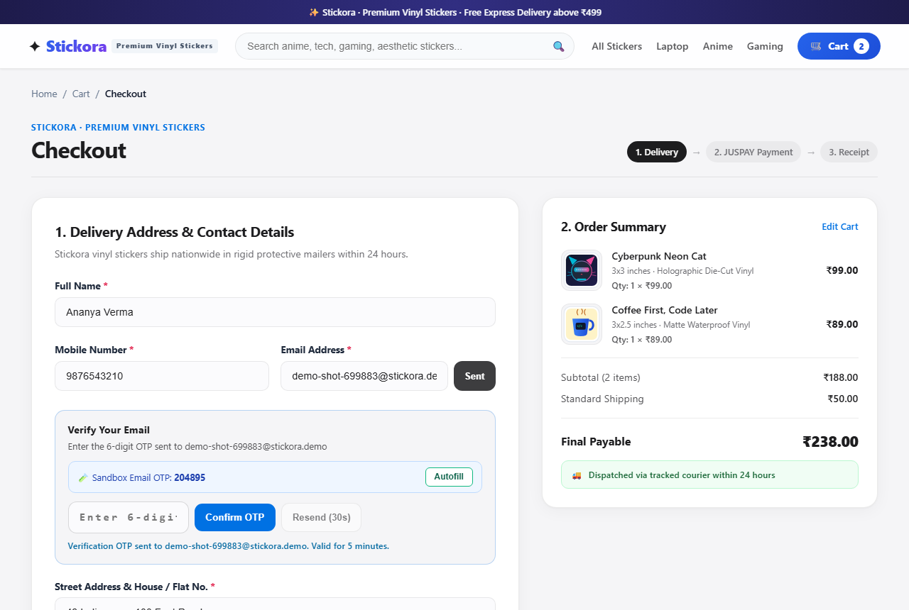
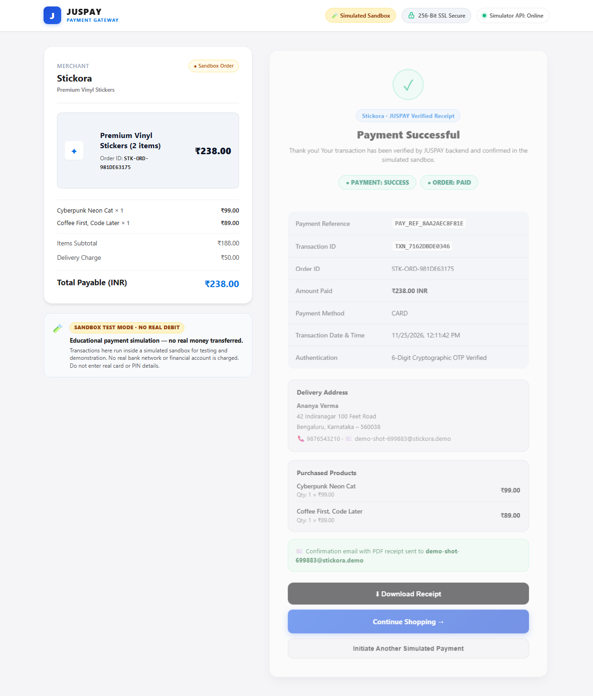
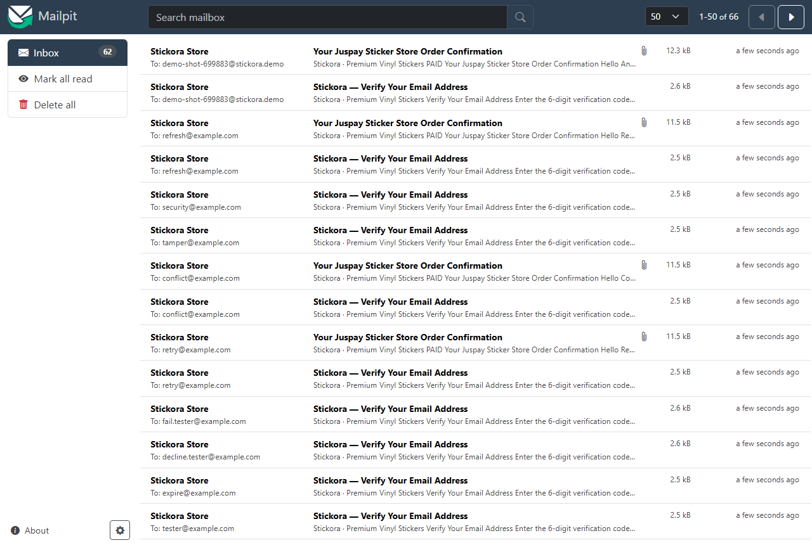

# Email OTP Verification & Automatic PDF Receipt — Implementation Report

**Status:** `COMPLETE & VERIFIED`  
**Live SMTP Verification:** Executed against real Docker Mailpit SMTP server (`localhost:1025`, Web UI `http://localhost:8025`) with real HTML emails and `reportlab`-generated PDF attachments inspected via `pypdf` and Playwright.

---

## 1. Feature Summary & Architecture

### Feature 1 — Customer Email Verification (Independent from Payment OTP)
- **Database Model (`backend/app/models/email_verification.py`):** Added `EmailVerificationSession` (`email_verification_sessions` table) storing `session_id` (`EVS_...`), normalized `email`, `status` (`PENDING`, `VERIFIED`, `FAILED`, `EXPIRED`), keyed HMAC-SHA256 `otp_hash`, `otp_expires_at`, `otp_attempts`, `resend_count`, `last_otp_sent_at`, `verified_at`, and `verification_token_hash`.
- **Service (`backend/app/services/email_verification_service.py`):**
  - Cryptographically secure 6-digit OTP via `secrets.randbelow(900000) + 100000`.
  - Keyed HMAC-SHA256 binding `EMAIL_OTP:{session_id}:{email}:{otp}` with constant-time verification (`hmac.compare_digest`).
  - 5-minute TTL, 3-attempt lockout (`FAILED`), 30-second resend cooldown (`429`), max 3 resends (`429`), immediate prior OTP invalidation on resend, strict cross-email verification blocking (`403`), and zero OTP exposure in production (`simulated_otp = None`) or logs.
- **API Routes (`backend/app/routes/email_verification.py`):**
  - `POST /api/v1/email-verification/send-otp`
  - `POST /api/v1/email-verification/verify-otp`
  - `GET /api/v1/email-verification/status/{session_id}`
- **Backend Order Enforcement (`backend/app/services/store_service.py`):** When `EMAIL_VERIFICATION_ENABLED=True`, `create_store_order` verifies `email_verification_session_id` and `email_verification_token` against PostgreSQL before creating any `PENDING_PAYMENT` order, persisting `email_verified=True`, `email_verified_at`, and `email_verification_session_id` on `StoreOrder`.
- **Checkout UI (`frontend/web/app/checkout/page.tsx`):**
  - Inline **Verify Email** button next to email input, 6-digit Email OTP verification box with resend cooldown timer & sandbox autofill pill, green **✓ Email Verified** badge, automatic reset if email changes, and order placement guard.

### Feature 2, 3, 4 & 5 — Automatic Confirmation Email, PDF Receipt & Reliable SMTP Delivery
- **Authoritative PDF Generator (`backend/app/services/pdf_receipt_service.py`):** Uses `reportlab` to build a structured A4 PDF receipt (`Stickora-Receipt-{order_id}.pdf`) strictly from PostgreSQL `StoreOrder`, `StoreOrderItem`, `CustomerDelivery`, and `PaymentTransaction` rows. Includes customer name/email, Order ID, Transaction ID, Payment Reference, purchased items, quantities, unit prices, subtotal, delivery charge, final amount paid, payment method, `Payment Status: SUCCESS`, `Order Status: PAID`, delivery address summary, and timestamp.
- **SMTP Service (`backend/app/services/email_service.py`):**
  - Configurable via `SMTP_HOST`, `SMTP_PORT`, `SMTP_USERNAME`, `SMTP_PASSWORD`, `SMTP_FROM_EMAIL`, `SMTP_FROM_NAME`, `SMTP_USE_TLS`, `SMTP_USE_SSL`, `EMAIL_VERIFICATION_ENABLED`.
  - Automatically skips `SMTP AUTH` when connecting to local unauthenticated SMTP capture servers (e.g., Mailpit `localhost:1025`) while authenticating over TLS/SSL when the server advertises `AUTH`.
  - Sends HTML + plain-text order confirmation (`Subject: Your Juspay Sticker Store Order Confirmation`) with the PDF attached **only** after backend-confirmed `SUCCESS` payment and `PAID` order status.
  - Prevents duplicates (`SELECT ... FOR UPDATE` + `receipt_email_status == 'SENT'`), retries transient SMTP errors up to `3` times, never rolls back a `PAID` order on SMTP failure (recording `receipt_email_status = 'FAILED'`, `receipt_email_attempts`), and never exposes internal SMTP credentials.
  - Exposes `POST /api/v1/store/orders/{order_id}/retry-receipt` and `GET /api/v1/store/orders/{order_id}/receipt-pdf` (protected by `X-Order-Token` / `?token=`).
- **Docker Local Email Capture (`docker-compose.yml`):** Added `axllent/mailpit:latest` (`juspay_mailpit` on SMTP port `1025`, Web UI `http://localhost:8025`).

---

## 2. Automated Test Verification

| Suite | Scope | Result | Exit Code |
| :--- | :--- | :--- | :---: |
| **Backend Pytest** (`backend/tests/`) | 88 tests total (including 11 tests covering all 13 Email OTP & PDF Receipt cases + live Mailpit & `pypdf` validation) | **88 passed**, 0 failed (`10.23s`) | `0` |
| **Frontend `tsc` & `next build`** | Full TypeScript validation + production Next.js compilation (8/8 routes) | **Passed**, 0 errors | `0` |
| **Playwright `tsc`** (`automation/web`) | Automation framework TypeScript compilation | **Passed**, 0 errors | `0` |
| **Playwright E2E Suite** (`automation/web/tests/`) | 61 Chromium browser tests across 13 specs (including `email-verification-and-receipt.spec.ts` verifying Mailpit inbox & PDF download) | **61 passed**, 0 failed (`1.9m`) | `0` |

---

## 3. Visual Evidence

### Checkout Email Verification OTP Flow

### Order Confirmation Receipt & Email Delivery Indicator

### Live Mailpit Inbox Capturing OTP & Order Confirmation + PDF Receipt

---

## 4. Known Limitations
- In local development (`ENVIRONMENT=development`), `simulated_otp` is returned in API responses and rendered as a sandbox autofill helper for automated tests/demos; in `ENVIRONMENT=production`, `simulated_otp` is strictly `null` and real SMTP credentials (`SMTP_HOST`, `SMTP_PORT`, `SMTP_USERNAME`, `SMTP_PASSWORD`, `SMTP_USE_TLS=True`) must be supplied in `.env`.
- Payment transactions remain simulated in the sandbox (`Educational payment simulation — no real money transferred.`).
