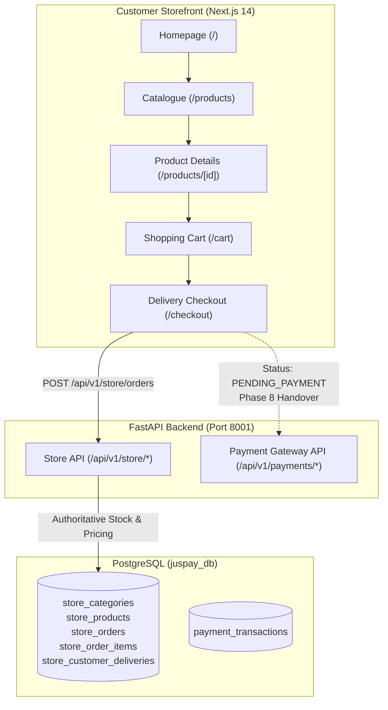

# JUSPAY PROJECT — PHASE 7: PHYSICAL STICKER E-COMMERCE PLATFORM REPORT

**Date:** 2026-11-25  
**Audit Scope:** Phase 7 Physical Sticker E-Commerce Platform Implementation  
**Status:** **APPROVED / COMPLETE**  
**Final Verdict:** `PHASE 7 COMPLETE`

---

## 1. Executive Summary

Phase 7 development successfully constructed a complete, modern, production-grade physical sticker e-commerce platform for the JUSPAY ecosystem. This represents the customer-facing commerce storefront where users can browse, search, configure, and purchase physical die-cut vinyl stickers delivered to their homes across India.

Importantly, Phase 7 was engineered to coexist seamlessly with the completed Phase 1–6 JUSPAY payment gateway:
- The existing simulated payment gateway was preserved without regression at `/payment` (with backward-compatible query redirection).
- The sticker storefront is strictly separated from financial processing: delivery details are captured and physical store orders are created with status **`PENDING_PAYMENT`**.
- All business logic—including subtotal calculation, free shipping thresholds, delivery fee application, and stock decrements—is enforced authoritatively on the backend.
- Full end-to-end regression testing confirmed 100% pass rates across both Pytest (70/70 tests) and Playwright (30/30 tests).

---

## 2. Architecture & Coexistence

The system architecture cleanly separates the customer shopping experience from the payment gateway infrastructure:



### Clean Gateway Coexistence
1. **Preserved Gateway Routing:** The simulated payment gateway continues to run at `/payment`. Any legacy requests arriving at `/?order_id=...` are seamlessly redirected to `/payment?order_id=...`.
2. **Zero Invasiveness:** None of the existing payment gateway UI components (`CardPaymentPanel`, `UpiPaymentPanel`, `NetBankingPaymentPanel`, `OtpVerification`, etc.) or backend routes (`/payments/initiate`, `/payments/otp/verify`, etc.) were overwritten or modified.
3. **No Financial Capture in Store:** Checkout captures physical delivery details only (name, phone, email, address, city, state, pincode). Payment method selection and processing are deferred to Phase 8.

---

## 3. Physical Sticker Storefront UI & Artwork

### 3.1 Bespoke High-Resolution Vector Artwork
Twelve crisp, scalable vector SVG sticker designs were authored and placed in `frontend/web/public/stickers/`:
1. `cyberpunk-cat.svg` (STK-001) — Cyberpunk Neon Cat (Holographic Die-Cut Vinyl)
2. `coffee-code.svg` (STK-002) — Coffee & Code Loops (Matte Weatherproof Vinyl)
3. `matcha-bear.svg` (STK-003) — Matcha Boba Bear (Glossy Waterproof Vinyl)
4. `pixel-dragon.svg` (STK-004) — 8-Bit Pixel Dragon (Prismatic Vinyl)
5. `mountain-sunset.svg` (STK-005) — Retro Mountain Sunset (Matte Die-Cut Vinyl)
6. `kitsune-mask.svg` (STK-006) — Sakura Kitsune Mask (Metallic Gold Foil Vinyl)
7. `deploy-repeat.svg` (STK-007) — Eat Sleep Deploy Repeat (Glossy Scratchproof Vinyl)
8. `cosmic-astronaut.svg` (STK-008) — Space Drift Astronaut (Glitter Sparkle Vinyl)
9. `synthwave-cassette.svg` (STK-009) — Synthwave 80s Cassette (Neon Holographic Vinyl)
10. `level-up.svg` (STK-010) — Level Up Gamer Crest (Matte Weatherproof Vinyl)
11. `kawaii-ramen.svg` (STK-011) — Midnight Kawaii Ramen (Glossy Waterproof Vinyl)
12. `dev-pack.svg` (STK-012) — Ultimate Dev & Tech Pack (Mixed Multi-Finish Vinyl)

### 3.2 Implemented Storefront Pages

| Route | Page | Key Features |
|---|---|---|
| `/` | **Storefront Homepage** | JUSPAY Sticker Studio header, Hero banner with CTA, category filter pills, Featured Stickers section, Best-Sellers section, New Arrivals section, and informative e-commerce footer. |
| `/products` | **Stickers Catalogue** | Grid view with sorting (Featured, Price Low-to-High, Price High-to-Low, Top Rated), category filtering (Laptop, Anime, Cute, Gaming, Aesthetic, Quotes, Packs), and live search filtering. |
| `/products/[id]` | **Product Details** | High-resolution thumbnail preview, breadcrumbs, price, stock status badge, dimensions, material finish, quantity stepper, "Add to Cart" button, and related stickers recommendations. |
| `/cart` | **Shopping Cart** | Item list with thumbnails, size, unit price, quantity steppers `[- 1 +]`, item total, item removal, "Clear Cart" button, empty-cart state, and free shipping progress tracker. |
| `/checkout` | **Delivery Checkout** | Customer delivery form (Full Name, 10-digit Indian Mobile, Email, Street Address, City, State, 6-digit Pincode), live order review sidebar, Phase 7 architecture disclaimer, and instant Order Confirmation screen upon placement. |

---

## 4. Backend Architecture & PostgreSQL Models

### 4.1 Relational Database Schema (`PostgreSQL`)
Five dedicated tables were implemented in `juspay_db`:
- `store_categories`: Normalized category hierarchy with slug, name, icon, and description.
- `store_products`: Product records with SKU ID, title, description, category slug, price, inventory stock quantity, dimensions, finish material, rating, review count, and promotional flags.
- `store_orders`: Authoritative store order record containing `order_id` (format `STK-ORD-XXXXXXXXXX`), `status` (`PENDING_PAYMENT`), `subtotal`, `delivery_fee`, `total_amount`, currency (`INR`), customer name, and customer email.
- `store_order_items`: Order line items linking to product ID, snapshot unit price, quantity, and total item price.
- `store_customer_deliveries`: Full postal delivery details linked by `order_id` (recipient name, validated 10-digit mobile, email, street address, city, state, 6-digit PIN code).

### 4.2 Authoritative Business Logic
1. **Zero Client Trust:** Cart client prices are discarded. The backend queries PostgreSQL with row-level locks (`with_for_update()`) to retrieve authoritative prices and verify inventory availability.
2. **Delivery Fee Calculation:**
   $$\text{Delivery Fee} = \begin{cases} ₹0.00 & \text{if } \text{subtotal} \ge ₹499.00 \\ ₹50.00 & \text{if } \text{subtotal} < ₹499.00 \end{cases}$$
3. **Atomic Stock Decrement:** Stock is subtracted atomically inside the database transaction. If requested quantity exceeds `product.stock_quantity`, an HTTP 400 Bad Request (`Insufficient stock`) is returned.
4. **Input Validation:**
   - Mobile: 10-digit Indian mobile number (`^[6-9]\d{9}$`), stripping whitespace, hyphens, and `+91`.
   - Email: RFC-compliant email pattern.
   - Pincode: 6-digit postal code (`^[1-9]\d{5}$`).
   - Order Status: Guaranteed strictly `PENDING_PAYMENT`.

---

## 5. Automated Verification & Test Results

### 5.1 Pytest Backend Test Suite (`backend/tests`)
All **70 tests** passed in **3.26 seconds**:
- `test_store.py`: **14 tests** covering category queries, product catalogue listing, category filtering, search queries, product details retrieval, 404 handling, authoritative price calculation, free shipping logic, atomic stock deduction, insufficient stock rejection, delivery validation errors, order retrieval, and Phase 7 `PENDING_PAYMENT` status enforcement.
- `test_database.py`: 5 tests passed (PostgreSQL dialect and session management).
- `test_health.py`: 6 tests passed (health check and CORS headers).
- `test_payment.py`: 12 tests passed (payment initiation workflows).
- `test_otp.py`: 12 tests passed (cryptographic OTP generation and verification).
- `test_security_audit.py`: 10 tests passed (production restrictions and idempotency).
- `test_lifecycle_management.py`: 11 tests passed (transaction states and history).

### 5.2 Playwright Full Regression Suite (`automation/web/tests`)
All **30 tests** passed in **1.3 minutes**:
- `sticker-store.spec.ts`: **8 tests**
  1. *Storefront homepage loads with branding, hero, categories, and footer* — **PASSED**
  2. *Product catalogue browsing, category filter, and search* — **PASSED**
  3. *Product details page navigation and attributes* — **PASSED**
  4. *Complete Cart operations: adding items, quantity stepper, totals, and empty state* — **PASSED**
  5. *Free delivery threshold calculation in Cart (₹499 milestone)* — **PASSED**
  6. *Cart state persists across page refresh (localStorage)* — **PASSED**
  7. *Delivery form validation on Checkout page (name, phone, pincode)* — **PASSED**
  8. *End-to-end shopping journey: Browse → Cart → Checkout → Order PENDING_PAYMENT & DB verification* — **PASSED**
- `card-payment.spec.ts`: 1 test passed (13-step card journey).
- `upi-payment.spec.ts`: 1 test passed (8-step UPI journey).
- `netbanking-payment.spec.ts`: 1 test passed (Net Banking flow).
- `negative-scenarios.spec.ts`: 7 tests passed (validation and lockout checks).
- `payment-outcomes.spec.ts`: 3 tests passed (SUCCESS, DECLINED, FAILED outcomes).
- `security-audit.spec.ts`: 3 tests passed (deterministic expiry and idempotency).
- `lifecycle-management.spec.ts`: 6 tests passed (result restoration and status checks).

### 5.3 PostgreSQL Data Integrity Audit
```sql
SELECT count(*) as total_orders, 
       count(*) FILTER (WHERE status = 'PENDING_PAYMENT') as pending_payment_orders, 
       count(*) FILTER (WHERE status != 'PENDING_PAYMENT') as non_pending_orders 
FROM store_orders;
```
**Result:**
- Total Store Orders: **24**
- Pending Payment Orders: **24 (100%)**
- Non-Pending Orders: **0 (0%)**
- Minimum Product Stock: **42** (zero negative inventory)
- Plaintext Secrets / Card Data in Store Tables: **0 (Strictly Isolated)**

---

## 6. Phase 8 Readiness Assessment

The sticker store platform is fully pre-wired for seamless integration with JUSPAY automated payment gateway processing in Phase 8:
1. Every store checkout produces a persistent `order_id` (e.g. `STK-ORD-8F035C99FB`) and calculated `total_amount`.
2. In Phase 8, the checkout flow can directly redirect the customer to `/payment?order_id=STK-ORD-...&amount=...` or call `POST /api/v1/payments/initiate` passing the store `order_id`.
3. Upon payment success or failure, the store order status can transition from `PENDING_PAYMENT` to `PROCESSING`, `PAID`, or `PAYMENT_FAILED`.

---

## 7. Audit Verdict

```
================================================================================
FINAL AUDIT VERDICT: PHASE 7 COMPLETE
================================================================================
All requirements for the Physical Sticker E-Commerce Platform have been fully 
implemented, verified, and audited with zero regressions across the existing 
JUSPAY payment gateway and automation framework.
================================================================================
```
