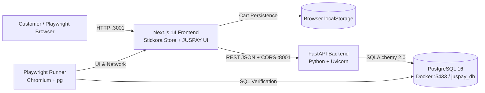
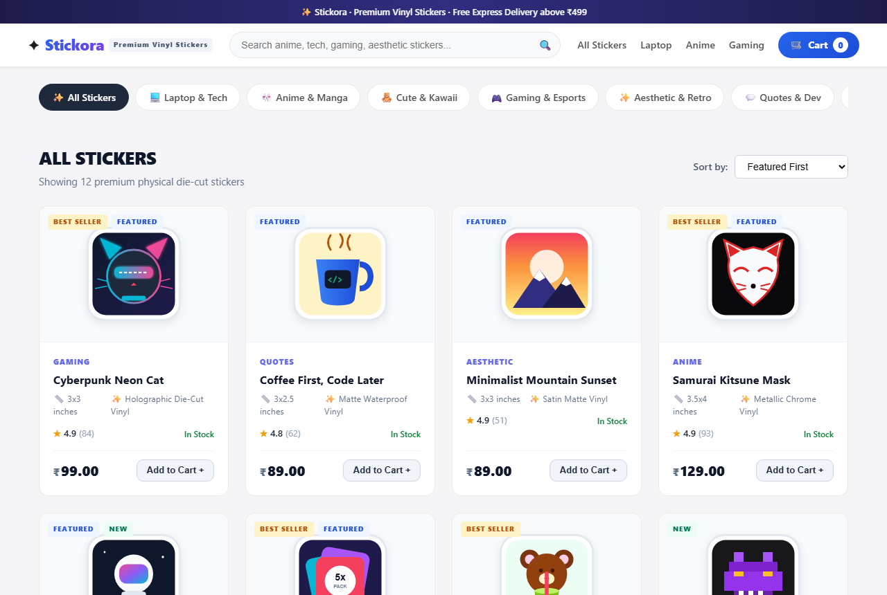
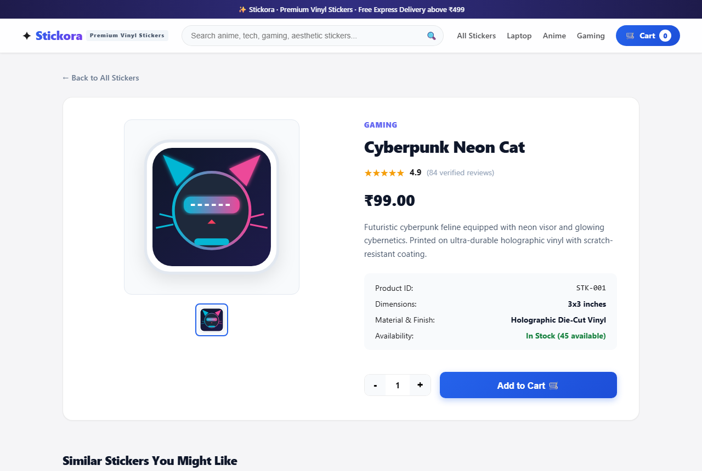
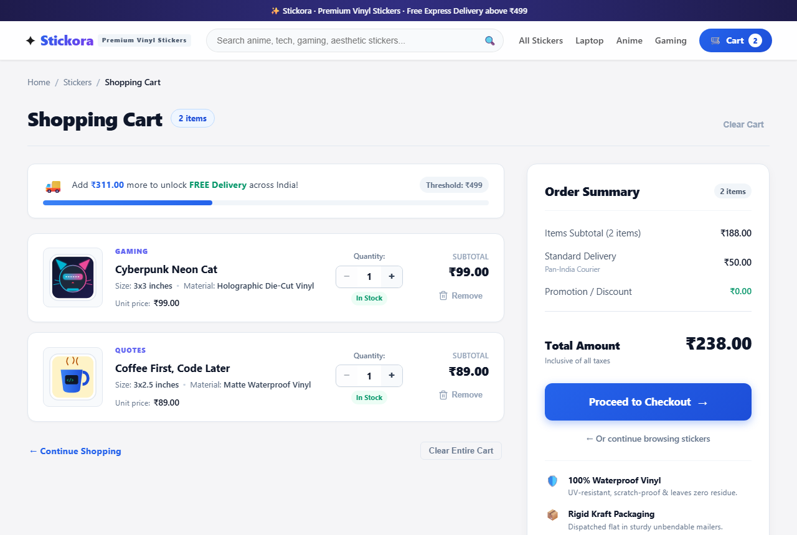
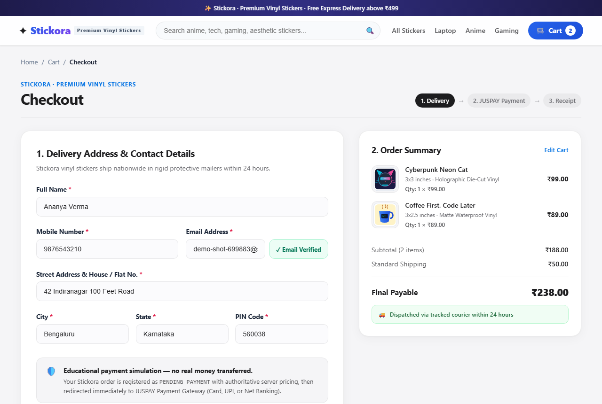
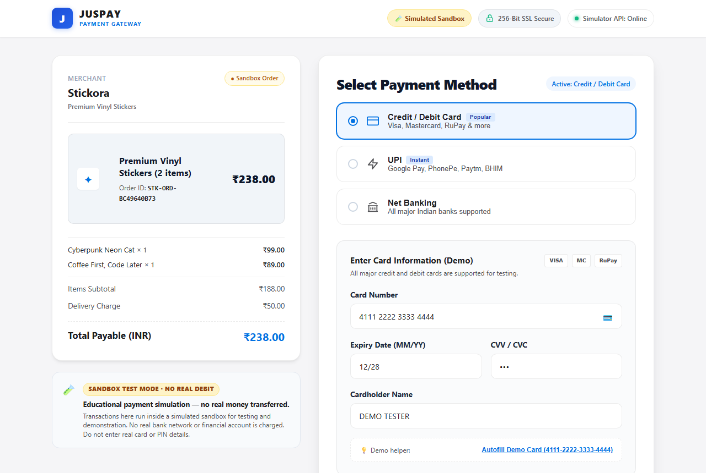
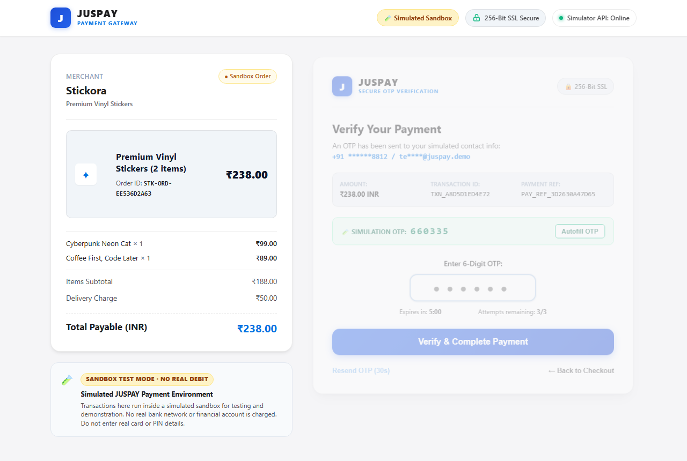
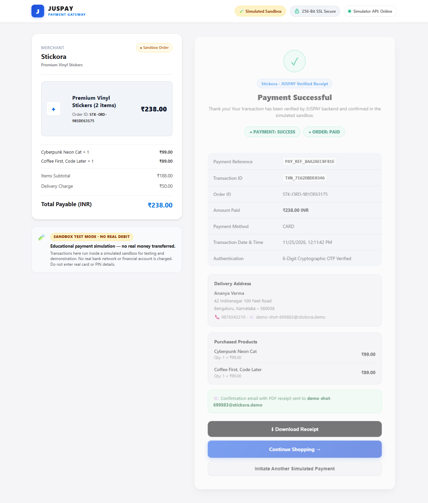

# Juspay Sticker Store Automation

A Full-Stack Physical Sticker E-Commerce Platform (**Stickora — Premium Vinyl Stickers**) with Simulated **JUSPAY** Payment Integration and End-to-End Test Automation.

---

## Project Overview

**Juspay Sticker Store Automation** combines a customer-facing physical sticker e-commerce storefront (**Stickora**) with a multi-method simulated payment gateway (**JUSPAY**) and full-stack automated verification:

- Physical sticker browsing, category filtering, keyword search, and product detail views
- Responsive shopping cart with quantity steppers, stock capping, and `localStorage` persistence
- Delivery checkout with Indian mobile/PIN validation, server-side pricing, and atomic stock reservation
- Simulated payment gateway supporting **Card**, **UPI**, and **Net Banking**
- Cryptographic 6-digit **OTP verification** (keyed HMAC-SHA256, 5-minute TTL, 3-attempt lockout, resend cooldown)
- Transaction lifecycle state machine (`PENDING -> AUTHENTICATED -> PROCESSING -> SUCCESS / DECLINED / FAILED`)
- Order lifecycle synchronization (`PENDING_PAYMENT -> PAID / PAYMENT_FAILED`) with stock restoration and safe retry
- Automated API testing with **Pytest** and browser + database E2E automation with **Playwright**

> **Note:** This is an educational project built for full-stack engineering and test automation practice. It is **not** an official Juspay product.

---

## Important Disclaimer

> **Educational payment simulation — no real money transferred.**
>
> This project uses a simulated payment gateway for educational and testing purposes. It does not process real financial transactions or connect to actual banking networks. Never enter real card details, banking credentials, or personal financial information.

---

## Features

### 1. Storefront & Product Catalogue (`Stickora — Premium Vinyl Stickers`)
- Branded homepage featuring Hero Banner, Category Pills (`Laptop`, `Anime`, `Cute`, `Gaming`, `Aesthetic`, `Quotes`, `Packs`), Featured Stickers, Best Sellers, and New Arrivals.
- Catalogue filtering by category and real-time keyword search (`/products`).
- Dedicated product details page (`/products/[id]`) with stock availability, dimensions, material finish, ratings, and quantity selection.

### 2. Shopping Cart
- Two-column desktop layout (cart items on left, sticky order summary on right) and overflow-free mobile responsive design.
- Quantity steppers preventing quantities below `1` and capping at `stock_quantity`.
- Dynamic free shipping calculator (Free Express Shipping at `₹499.00+`, otherwise `₹50.00`).
- Empty cart state with quick category exploration pills; persisted in browser `localStorage` (`juspay_sticker_cart_v1`).

### 3. Delivery Checkout & Customer Email Verification (`/checkout`)
- Two-column Apple-inspired responsive checkout with product thumbnail preview and itemized breakdown.
- **Customer Email OTP Verification**:
  - Dedicated **Verify Email** flow (`EVS_...`) separate from payment OTP (`TXN_...`).
  - Sends a cryptographically secure 6-digit OTP to the customer's email via SMTP, storing only a keyed HMAC-SHA256 hash (`email_verification_sessions`) with 5-minute TTL, max 3 incorrect attempts, max 3 resends, and 30-second cooldown.
  - Prevents cross-email verification and enforces verified email status server-side inside `POST /api/v1/store/orders`.
- Client and Pydantic server validation for Full Name, 10-digit Indian Mobile Number (`6–9...`), Verified Email, Street Address, City, State, and 6-digit PIN Code.
- Synchronous duplicate-submission lock (`useRef` + disabled loading state) on **Place Order (Pending Payment)**.
- Backend creates `StoreOrder` in PostgreSQL with initial status `PENDING_PAYMENT` and redirects directly to `/payment?order_id=...&token=...`.

### 4. Payment Initiation (`/payment`)
- Retains **JUSPAY Payment Gateway** branding alongside **Stickora** merchant summary and clear sandbox disclaimers.
- Contextual forms and validation for **Credit / Debit Card**, **UPI**, and **Net Banking**.
- Server-side authoritative amount verification against `store_orders.total_amount`.

### 5. Payment OTP Verification
- Generates 6-digit payment OTP via Python `secrets`, storing only a keyed HMAC-SHA256 hash (`otp_hash`).
- Constant-time hash comparison (`hmac.compare_digest`), 5-minute expiry, 3-attempt lockout, and 30s resend cooldown (max 3 resends).
- In `development` mode, provides a simulation OTP helper for deterministic automation/UI demos; strictly disabled (`null`) in `production` mode.

### 6. Transaction Management, Automatic Email Receipts & Authoritative PDF
- Enforces strict payment state transitions and updates `StoreOrder` to `PAID` **only** after backend-confirmed settlement (`POST /api/v1/payments/{id}/process` + `GET /api/v1/payments/{id}`).
- **Automatic Confirmation Email & PDF Receipt**:
  - Upon confirmed `SUCCESS` payment and `PAID` order status, automatically emails `"Your Juspay Sticker Store Order Confirmation"` with an HTML summary and authoritative `reportlab`-generated **PDF Receipt** (`Stickora-Receipt-{order_id}.pdf`) to the verified customer email.
  - Never sends receipts on `DECLINED` or `FAILED` payments, prevents duplicate receipts via row locking and `receipt_email_status`, never rolls back a `PAID` order if SMTP fails, and provides `POST /api/v1/store/orders/{order_id}/retry-receipt` + UI retry button.
  - Customers can also download the backend-generated PDF directly from the Success Receipt (`GET /api/v1/store/orders/{order_id}/receipt-pdf`).
- Dedicated screens for **Pending**, **Declined**, and **Failed** payments supporting safe payment retry without duplicate orders.

### 7. Security & Idempotency
- Card numbers and CVVs are validated in memory and **never persisted** in PostgreSQL or logs.
- `Idempotency-Key` support on payment initiation and processing endpoints (`409 Conflict` on mismatched replays or terminal re-processing).
- HMAC-protected order access tokens (`X-Order-Token` / `?token=`) preventing unauthorized order/address enumeration (`401`/`403`).

### 8. Browser Automation & Testing
- **88** backend Pytest integration/security/email/PDF unit & integration tests (`backend/tests/`).
- **61** Playwright E2E tests in TypeScript (`automation/web/tests/`) verifying browser workflows, PostgreSQL records, and live Mailpit SMTP captures.

---

## Technology Stack

| Layer | Technology | Version / Configuration |
| :--- | :--- | :--- |
| **Frontend** | Next.js, React, TypeScript | Next.js `^14.2.23`, React `^18.3.1`, TypeScript `^5.6.3` |
| **Backend** | Python, FastAPI, Uvicorn | Python `3.11`, FastAPI `0.110–0.120`, Pydantic `2.x` |
| **Database** | PostgreSQL + SQLAlchemy | PostgreSQL `16-alpine` (Docker port `5433`), SQLAlchemy `2.0` |
| **Backend Testing** | Pytest, HTTPX | Pytest `>=8.0.0`, HTTPX `>=0.27.0` |
| **E2E Automation** | Playwright, TypeScript, `pg` | `@playwright/test ^1.49.0`, Chromium |
| **Containerization** | Docker Compose | `docker-compose.yml` (`juspay_postgres`) |

---

## Application Architecture



See [docs/ARCHITECTURE.md](docs/ARCHITECTURE.md) and [docs/PROJECT_WORKFLOW.md](docs/PROJECT_WORKFLOW.md) for detailed component and state-transition diagrams.

---

## Complete Customer Workflow

1. **Browse Stickers** on `/` or `/products`.
2. **Inspect Product Details** on `/products/[id]` and **Add to Cart**.
3. **Update Cart Quantities** on `/cart` (`1..stock_quantity`) and observe live subtotal + shipping (`FREE` at `₹499+`, else `₹50`).
4. **Enter Delivery Information** on `/checkout` (Full Name, Indian Mobile, Email, Address, City, State, PIN Code).
5. **Click "Place Order (Pending Payment)"** → backend validates stock, computes authoritative pricing, reserves inventory, and creates a `StoreOrder` with status `PENDING_PAYMENT`.
6. **Redirect to JUSPAY Payment Gateway** (`/payment?order_id=...&token=...`) showing Merchant `Stickora`, Order ID, and authoritative payable total.
7. **Select Payment Method** (`CARD`, `UPI`, or `NET_BANKING`) and submit → `POST /api/v1/payments/initiate` creates a `PENDING` transaction.
8. **Verify 6-Digit OTP** → `POST /api/v1/payments/{id}/verify-otp` transitions the transaction to `AUTHENTICATED`.
9. **Process Simulated Payment** → `POST /api/v1/payments/{id}/process` settles the transaction (`SUCCESS`, `DECLINED`, or `FAILED`).
10. **Backend-Confirmed Order Update** → `StoreOrder.status` updates to `PAID` **only** after backend settlement confirmation (never merely because the browser navigated or rendered a UI screen). Failed/declined payments mark the order `PAYMENT_FAILED` and restore reserved stock.
11. **Order Confirmation Receipt** → displays transaction receipt, delivery details, purchased items, **Download Receipt**, and **Continue Shopping**.

---

## Project Folder Structure

```text
Juspay Payment Automation/
├── automation/
│   └── web/
│       ├── fixtures/                # Playwright test fixtures (StorePage, CheckoutPage, OtpPage, ResultPage)
│       ├── pages/                   # Page Object Model classes
│       ├── screenshots/             # Cart UI redesign verification captures
│       ├── test-data/               # Simulated Card/UPI/NetBanking test payloads
│       ├── tests/                   # 12 Playwright E2E spec suites (59 tests)
│       ├── utils/                   # PostgreSQL (`pg`) & API verification helpers
│       ├── package.json
│       └── playwright.config.ts     # Base URL http://localhost:3001, Chromium, retries
├── backend/
│   ├── app/
│   │   ├── core/                    # Settings (Pydantic BaseSettings) & controllable test clock
│   │   ├── database/                # SQLAlchemy engine, Base, session dependency, health ping
│   │   ├── models/                  # PaymentTransaction & Store ORM models
│   │   ├── routes/                  # FastAPI routers (health, store, payment, otp)
│   │   ├── schemas/                 # Pydantic v2 request/response validation schemas
│   │   ├── services/                # Store, Payment, and OTP business logic
│   │   └── main.py                  # FastAPI entrypoint, CORS, lifespan schema checks & seeding
│   ├── scripts/
│   │   └── audit_verification.py
│   ├── tests/                       # 8 Pytest suites (77 tests)
│   ├── pytest.ini
│   └── requirements.txt
├── docs/
│   ├── demo/                        # Screen-recording shot list & recording checklist
│   ├── screenshots/                 # Real application screenshots
│   ├── API_DOCUMENTATION.md
│   ├── ARCHITECTURE.md
│   ├── PROJECT_WORKFLOW.md
│   ├── SECURITY.md
│   └── TESTING_GUIDE.md
├── frontend/
│   └── web/
│       ├── app/                     # Next.js App Router pages (/, /products, /products/[id], /cart, /checkout, /payment)
│       ├── components/              # JUSPAY gateway & Stickora storefront components
│       ├── context/                 # CartContext (localStorage state)
│       ├── public/stickers/         # 12 vector sticker illustrations
│       ├── types/                   # TypeScript interfaces
│       ├── .env.example
│       ├── next.config.js
│       └── package.json
├── .env.example                     # Root environment template (placeholders only)
├── .gitignore
├── docker-compose.yml               # PostgreSQL 16 service mapped to host port 5433
└── README.md
```

---

## Installation and Setup (Windows PowerShell)

### Prerequisites
- **Python** 3.10+ (verified on Python `3.11.9`)
- **Node.js** 18+ (verified on Node.js `v24.21.0`, `npm 11.19.0`)
- **Docker Desktop** with Docker Compose
- **Git**

### 1. Clone the Repository
```powershell
git clone https://github.com/SrujanKindikeri/juspay-sticker-store-automation.git
cd juspay-sticker-store-automation
```

### 2. Configure Environment Variables
Copy the placeholder templates and fill in local development values:
```powershell
Copy-Item .env.example .env
Copy-Item frontend\web\.env.example frontend\web\.env.local
```
Update `.env` with your local `POSTGRES_USER`, `POSTGRES_PASSWORD`, `DATABASE_URL`, and a random `OTP_SECRET_KEY`.

### 3. Start PostgreSQL & Local Email Capture (Mailpit) with Docker Compose
```powershell
docker compose up -d
docker compose ps
```
- **PostgreSQL 16** runs in `juspay_postgres` on host port **`5433`**.
- **Mailpit SMTP Capture** runs in `juspay_mailpit`:
  - SMTP server: `localhost:1025` (captures all outgoing OTP and Order Confirmation + PDF emails safely without emailing real users)
  - Web Inbox UI: `http://localhost:8025` (inspect sent HTML emails, plain-text OTPs, and PDF attachments visually)

### 4. Backend Setup & Startup (`http://127.0.0.1:8001`)
```powershell
cd backend
python -m venv venv
.\venv\Scripts\Activate.ps1
pip install -r requirements.txt

# Tables and 12 sticker products are automatically initialized on startup
.\venv\Scripts\python.exe -m uvicorn app.main:app --host 127.0.0.1 --port 8001
```
- Backend API: `http://127.0.0.1:8001`
- Swagger UI: `http://127.0.0.1:8001/docs`
- Health Check: `http://127.0.0.1:8001/health`

### 5. Frontend Setup & Startup (`http://localhost:3001`)
Open a second PowerShell terminal:
```powershell
cd frontend\web
npm install
npm run dev
# Or for production server:
# npm run build
# npm run start
```
- Frontend Storefront: `http://localhost:3001`

---

## Environment Variables

Templates are tracked in [`.env.example`](.env.example) and [`frontend/web/.env.example`](frontend/web/.env.example) using placeholder values only. Actual `.env` and `.env.local` files are excluded via `.gitignore`.

| Variable | Scope | Purpose |
| :--- | :--- | :--- |
| `ENVIRONMENT` | Backend | `development` / `testing` / `production` (disables simulation overrides & OTP exposure in `production`) |
| `APP_NAME`, `APP_VERSION`, `DEBUG` | Backend | Service metadata and debug logging level |
| `BACKEND_HOST`, `BACKEND_PORT` | Backend | FastAPI bind host and port (`8001`) |
| `POSTGRES_USER`, `POSTGRES_PASSWORD`, `POSTGRES_DB`, `POSTGRES_HOST`, `POSTGRES_PORT`, `DATABASE_URL` | Backend / Docker / Playwright DB Utils | PostgreSQL connection details (host port `5433`, DB `juspay_db`) |
| `ALLOWED_ORIGINS` | Backend | Comma-separated CORS origins (`http://localhost:3001`, etc.) |
| `OTP_SECRET_KEY` | Backend | Server HMAC-SHA256 key for OTP hashes & order access tokens |
| `OTP_EXPIRY_MINUTES`, `OTP_MAX_ATTEMPTS`, `OTP_RESEND_COOLDOWN_SECONDS`, `OTP_MAX_RESENDS` | Backend | OTP TTL (`5`), max attempts (`3`), resend cooldown (`30s`), max resends (`3`) |
| `EMAIL_VERIFICATION_ENABLED` | Backend | Enforces verified email status when creating store orders (`True`) |
| `SMTP_HOST`, `SMTP_PORT`, `SMTP_USERNAME`, `SMTP_PASSWORD`, `SMTP_USE_TLS`, `SMTP_USE_SSL` | Backend | SMTP provider settings (defaults to local Mailpit `localhost:1025`; set credentials & TLS for production SMTP) |
| `SMTP_FROM_EMAIL`, `SMTP_FROM_NAME` | Backend | Sender address and display name for OTP & confirmation receipt emails |
| `NEXT_PUBLIC_API_URL`, `NEXT_PUBLIC_APP_NAME`, `PORT` | Frontend | Backend base URL (`http://localhost:8001`), app title, Next.js port (`3001`) |

---

## API Documentation

Full endpoint schemas, parameters, and validation rules are documented in [docs/API_DOCUMENTATION.md](docs/API_DOCUMENTATION.md).

Summary of implemented endpoints:
- **Health**: `GET /health`, `GET /api/v1/health`, `GET /`
- **Store & Products**: `GET /api/v1/store/categories`, `GET /api/v1/store/products`, `GET /api/v1/store/products/{product_id}`
- **Email Verification**: `POST /api/v1/email-verification/send-otp`, `POST /api/v1/email-verification/verify-otp`, `GET /api/v1/email-verification/status/{session_id}`
- **Orders & Receipts**: `POST /api/v1/store/orders`, `GET /api/v1/store/orders/{order_id}`, `POST /api/v1/store/orders/{order_id}/retry-receipt`, `GET /api/v1/store/orders/{order_id}/receipt-pdf`
- **Payments**: `POST /api/v1/payments/initiate`, `POST /api/v1/payments/{transaction_id}/process`, `GET /api/v1/payments/{transaction_id}`, `GET /api/v1/payments`
- **Payment OTP**: `POST /api/v1/payments/{transaction_id}/send-otp`, `POST /api/v1/payments/{transaction_id}/verify-otp`, `POST /api/v1/payments/{transaction_id}/resend-otp`, `GET /api/v1/payments/{transaction_id}/otp-status`

---

## Testing Instructions

Refer to [docs/TESTING_GUIDE.md](docs/TESTING_GUIDE.md) for detailed instructions.

| Check / Suite | Command | Latest Observed Result |
| :--- | :--- | :--- |
| **Backend Pytest** | `cd backend; .\venv\Scripts\pytest.exe -v tests` | **88 passed** (`0 failed`, exit code `0`) |
| **Frontend TypeScript** | `cd frontend\web; npx tsc --noEmit` | **Passed** (exit code `0`) |
| **Frontend Production Build** | `cd frontend\web; npm run build` | **Passed** (exit code `0`) |
| **Playwright TypeScript** | `cd automation\web; npx tsc --noEmit` | **Passed** (exit code `0`) |
| **Playwright E2E Suite** | `cd automation\web; npx playwright test --reporter=list` | **61 passed** (`0 failed`, exit code `0`) |

---

## Security

Security controls, OTP cryptography, idempotency, token authorization, and known pre-production limitations are detailed in [docs/SECURITY.md](docs/SECURITY.md).

---

## Screenshots

Captured directly from the live running Next.js + FastAPI + PostgreSQL application (`docs/screenshots/`):

| Homepage | Product Catalogue |
| :---: | :---: |
|  |  |

| Product Details | Shopping Cart |
| :---: | :---: |
|  |  |

| Delivery Checkout | Payment Method Selection |
| :---: | :---: |
|  |  |

| OTP Verification | Order Confirmation Receipt |
| :---: | :---: |
|  |  |

---

## Future Improvements

- Integration with an official payment gateway sandbox/live SDK and signed webhook callbacks.
- Customer authentication and session management (JWT / OAuth) for order history and admin endpoints.
- Cloud deployment configuration (managed PostgreSQL, HTTPS termination, secret manager integration).
- Rate limiting and brute-force protection middleware across API routes.
