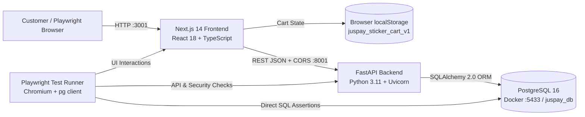

# System Architecture — Stickora & Simulated JUSPAY Payment Gateway

## 1. High-Level Architecture

The **Juspay Sticker Store Automation** platform (**Stickora — Premium Vinyl Stickers**) follows a decoupled, three-tier full-stack architecture paired with an end-to-end Playwright browser automation suite:

## 2. Layer Responsibilities

### A. Presentation Layer (`frontend/web/`)
- **Framework**: Next.js 14 (App Router), React 18, TypeScript.
- **Storefront & Catalogue**:
  - `/` (`app/page.tsx`): Stickora homepage featuring hero banner, category filter pills, featured items, best sellers, and new arrivals.
  - `/products` (`app/products/page.tsx`): Full catalogue supporting category filtering and search queries.
  - `/products/[id]` (`app/products/[id]/page.tsx`): Individual product details with stock status, dimensions, material, and add-to-cart controls.
  - `/cart` (`app/cart/page.tsx`): Two-column responsive cart with quantity steppers, free shipping progress tracker (`₹499` threshold), and sticky order summary.
- **Checkout & Payment Flow**:
  - `/checkout` (`app/checkout/page.tsx`): Delivery details validation, client duplicate-submit lock (`useRef` + `disabled`), order creation (`POST /api/v1/store/orders`), cart clearing, and redirect to `/payment?order_id=...&token=...`.
  - `/payment` (`app/payment/page.tsx`): Simulated JUSPAY Payment Gateway supporting Card, UPI, and Net Banking, OTP verification (`OtpVerification.tsx`), backend status verification, downloadable receipt, and dedicated `PENDING`, `DECLINED`, and `FAILED` recovery screens.

### B. Application & Business Logic Layer (`backend/app/`)
- **API Routers (`backend/app/routes/`)**:
  - `health.py`: Database connectivity check and operational status.
  - `store.py`: Categories, product catalogue, store order creation, and token-protected order lookup.
  - `payment.py`: Payment initiation, payment processing, transaction status, and paginated history.
  - `otp.py`: Cryptographic OTP generation/dispatch, constant-time verification, resend rate limiting, and OTP status.
- **Service Layer (`backend/app/services/`)**:
  - `store_service.py`: Catalogue seeding (`SAMPLE_CATEGORIES`, `SAMPLE_PRODUCTS`), row-locked inventory checks (`SELECT ... FOR UPDATE`), authoritative server-side pricing & shipping calculation (`FREE` above `₹499.0`, else `₹50.0`), HMAC-SHA256 order access token generation/verification, and inventory restoration on payment failure.
  - `payment_service.py`: Payment transaction creation, `Idempotency-Key` deduplication, authoritative store order amount verification, state machine transitions (`PENDING -> AUTHENTICATED -> PROCESSING -> SUCCESS / DECLINED / FAILED`), and store order synchronization (`PENDING_PAYMENT -> PAID / PAYMENT_FAILED`).
  - `otp_service.py`: Cryptographically secure 6-digit OTP generation (`secrets`), keyed HMAC-SHA256 hashing (`hmac.compare_digest`), 5-minute TTL expiry, 3-attempt lockout, 30-second resend cooldown, and max 3 resends.

### C. Persistence Layer (`PostgreSQL 16` via `docker-compose.yml`)
- **`store_categories`**: Sticker categories (`laptop`, `anime`, `cute`, `gaming`, `aesthetic`, `quotes`, `packs`).
- **`store_products`**: 12 physical vinyl sticker SKUs (`STK-001` through `STK-012`) with authoritative INR prices and real-time `stock_quantity`.
- **`store_orders`**: Customer orders (`STK-ORD-...`) tracking `status` (`PENDING_PAYMENT`, `PAID`, `PAYMENT_FAILED`), subtotal, delivery fee, `total_amount`, `order_token_hash`, `stock_reserved`, and linked payment references.
- **`store_order_items`**: Snapshot line items linked to each order.
- **`store_customer_deliveries`**: Validated Indian shipping address and contact details per order.
- **`payment_transactions`**: Simulated payment records (`TXN_...`, `PAY_REF_...`) storing masked/non-sensitive metadata, keyed `otp_hash`, lifecycle timestamps, and `idempotency_key`. Sensitive PAN/CVV numbers are never persisted.
