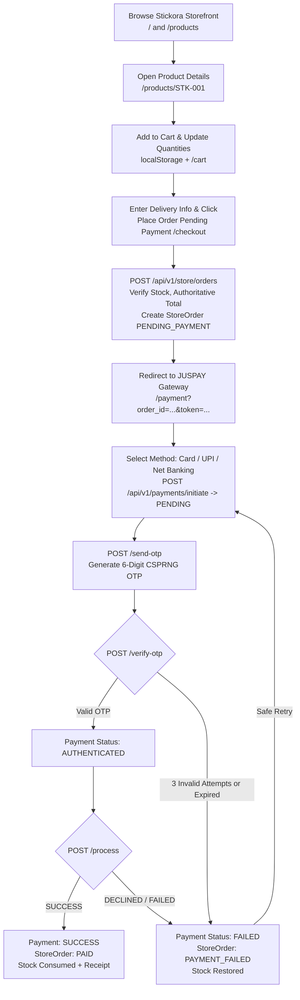

# Customer & Transaction Lifecycle Workflow

## 1. End-to-End Customer & Payment Flow

## 2. Store Order & Payment State Guarantees

1. **Order Creation (`PENDING_PAYMENT`)**: Clicking **Place Order (Pending Payment)** validates customer/delivery details, creates the `StoreOrder` record in PostgreSQL with `status = 'PENDING_PAYMENT'`, reserves inventory (`stock_reserved = True`), clears the cart, and navigates to `/payment?order_id=...&token=...`. Orders are **never** marked `PAID` at creation.
2. **Payment Initiation (`PENDING`)**: Submitting Card, UPI, or Net Banking details validates the contextual payload and checks `amount == order.total_amount` on the backend before creating a `PaymentTransaction` with `status = 'PENDING'`.
3. **OTP Authentication (`AUTHENTICATED`)**: Verifying the 6-digit OTP moves the payment transaction to `AUTHENTICATED` (it does **not** prematurely complete the payment).
4. **Backend Settlement (`PROCESSING -> SUCCESS | DECLINED | FAILED`)**: Calling `POST /api/v1/payments/{id}/process` executes final settlement and synchronizes `store_orders`:
   - Only after backend confirmation via `POST /process` and verification against `GET /api/v1/payments/{id}` does the UI display the **Payment Success Receipt** and mark the store order `PAID`.
   - On `DECLINED` or `FAILED`, reserved stock is restored atomically (`stock_reserved = False`, `status = 'PAYMENT_FAILED'`) and the customer can safely retry payment without duplicating the order.
